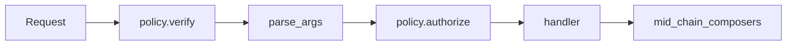

# Advanced usage

Enterprise APIs need **non-omittable policy**: auth, tenancy, and audit that cannot be forgotten on a new route. Middleware is one way to buy that. never-rest’s bet is different — policy is a declared map checked at construction, and mid-chain gates stay ordinary `Result` composition.

Short thesis: [concepts.md — No middleware](./concepts.md#no-middleware--the-chain-is-the-middleware). Admission order and what the library does not ship: [security-boundaries.md](./security-boundaries.md). Pattern catalogue (gates, tees, recover): [railway-patterns.md](./railway-patterns.md).



`definePolicy` is registration, not interception. It must name every operation. Composers remain the tool for mid-chain commercial gates — MSA signed, residency cleared — that run *after* the request is already an authenticated, authorised call.

## What enterprise actually asks for

| Quality | Meaning |
| --- | --- |
| **Mandatory** | Auth / tenancy / audit cannot be omitted on a new route |
| **Central** | Change the policy once; every route inherits it |
| **Ordered** | Identity before domain; audit after success |
| **Evidential** | You can show an auditor that the policy always runs |

`definePolicy` delivers the first three at construction. A missing key, an unknown key, or an entry that is neither a function nor `'public'` throws `ContractConfigurationError` — including for JavaScript callers and `as never` casts. Mid-chain composers plus capability types deliver the rest.

## `definePolicy`

HTTP `verify` reads headers only. Authorization runs after parse, so it sees validated `args`. Local adapters pass an already-established principal; a protected operation without one returns `boundary.unauthenticated`. Passing both `policy` and `disclosure` is a configuration error — disclosure comes from the principal.

<!-- check -->
```ts
import { err, ok } from 'neverthrow';
import { z } from 'zod';
import { railError } from '@eddy-works/never-rest';
import type { ContractDef } from '@eddy-works/never-rest/contract';
import { definePolicy } from '@eddy-works/never-rest/policy';
import { serve } from '@eddy-works/never-rest/server';
import { createDispatcher, type LocalHandlers } from '@eddy-works/never-rest/local';

type Principal = { readonly id: string; readonly role: 'operator' | 'reader' };

const contract = {
  getDoc: {
    method: 'GET',
    path: '/docs/:id',
    params: z.object({ id: z.string() }),
    output: z.object({ id: z.string() }),
    errors: { not_found: 404 },
  },
  health: {
    method: 'GET',
    path: '/health',
    output: z.object({ ok: z.literal(true) }),
    errors: {},
  },
} as const satisfies ContractDef;

function verifyBearer(request: Request) {
  const header = request.headers.get('authorization');
  if (header !== 'Bearer operator') {
    return ok(undefined);
  }
  return ok({ id: 'ada', role: 'operator' as const } satisfies Principal);
}

function canRead(principal: Principal, id: string) {
  if (principal.role !== 'operator' && id.startsWith('secret-')) {
    return err(railError('boundary.forbidden', 'Forbidden'));
  }
  return ok(undefined);
}

const policy = definePolicy(contract, {
  verify: (request) => verifyBearer(request),
  operations: {
    getDoc: ({ principal, args }) => {
      if (principal === undefined) {
        return err(railError('boundary.unauthenticated', 'Authentication required'));
      }
      return canRead(principal, args.params.id);
    },
    health: 'public',
  },
  disclosure: (principal) =>
    principal?.role === 'operator' ? 'internal' : 'public',
});

const handlers: LocalHandlers<typeof contract, undefined, Principal> = {
  getDoc: ({ params }) => ok({ id: params.id }),
  health: () => ok({ ok: true as const }),
};

const fetchHandler = serve(contract, handlers, { policy });

const dispatcher = createDispatcher(contract, handlers, { policy });

void fetchHandler;
void dispatcher;
```

Failures deny. A verifier that throws becomes `boundary.unauthenticated` (401). An authorizer that throws becomes `boundary.forbidden` (403). The thrown cause is visible only at `full`.

Handlers receive `principal`, typed through a third generic that defaults to `undefined`. Raise disclosure from that principal, not from a caller-supplied header.

## Capability types

A gate should produce a **capability**, not a boolean. Domain functions refuse to run without it. Omitting the gate becomes a type error.

<!-- check -->
```ts
import { errAsync, okAsync, type ResultAsync } from 'neverthrow';
import { railError, type RailError } from '@eddy-works/never-rest';

type Session = { userId: string; roles: readonly string[] };

type Invoice = { id: string; ownerId: string; total: number };

function requireAuth(request: Request): ResultAsync<Session, RailError<'unauthorized'>> {
  const header = request.headers.get('authorization');
  if (header === null) {
    return errAsync(railError('unauthorized', 'Missing credentials'));
  }
  return okAsync({ userId: header, roles: ['billing'] });
}

function loadInvoiceFor(
  session: Session,
  id: string,
): ResultAsync<Invoice, RailError<'not_found' | 'forbidden'>> {
  if (id === 'missing') {
    return errAsync(railError('not_found', 'Missing invoice'));
  }
  if (session.userId !== 'owner' && !session.roles.includes('billing')) {
    return errAsync(railError('forbidden', 'Not your invoice'));
  }
  return okAsync({ id, ownerId: session.userId, total: 10 });
}

const getInvoice = ({
  params,
  request,
}: {
  params: { id: string };
  request: Request;
}) => requireAuth(request).andThen((session) => loadInvoiceFor(session, params.id));

void getInvoice;

// @ts-expect-error — string is not Session
loadInvoiceFor('anonymous', 'inv-1');
```

Same pattern for `TenantContext`, `ResidencyCleared`, and other mid-chain clearances. Use this *inside* a handler after `definePolicy` has already established the principal.

## Composer wrappers

Capabilities stop illegal *calls*. Composers make a mid-chain gate **central**: change `withRole` once; every route that uses it inherits the gate. Public HTTP surfaces stay on `definePolicy` (`health: 'public'`). Composers are for product gates that are not the admission principal.

```ts
import type { Result, ResultAsync } from 'neverthrow';
import type { RailError } from '@eddy-works/never-rest';
import type { HandlerArgsOf, OutputOf, RouteDef } from '@eddy-works/never-rest/contract';
import type { Handler } from '@eddy-works/never-rest/server';

type Session = { userId: string; roles: readonly string[] };

type AuthedArgs<TRoute extends RouteDef, TContext> = HandlerArgsOf<TRoute> & {
  request: Request;
  context: TContext;
  principal: unknown;
  signal: AbortSignal;
  session: Session;
};

type AuthedHandler<TRoute extends RouteDef, TContext> = (
  args: AuthedArgs<TRoute, TContext>,
) =>
  | Result<OutputOf<TRoute>, RailError<keyof TRoute['errors'] & string>>
  | ResultAsync<OutputOf<TRoute>, RailError<keyof TRoute['errors'] & string>>;

function withSession<TRoute extends RouteDef, TContext>(
  handler: AuthedHandler<TRoute, TContext>,
): Handler<TRoute, TContext> {
  return (args) =>
    requireAuth(args.request).andThen((session) => handler({ ...args, session }));
}
```

Layer composers the same way: `withTenant(withSession(handler))`. Ordered lives in the wrapper body.

## What stays outside the railway

Host chrome and ingress policy are not `Result` concerns. They must run regardless of which route matched — often before your process sees the request. See [security-boundaries.md](./security-boundaries.md).

| Need | Why a handler chain is not enough |
| --- | --- |
| Edge auth for *all* traffic including unknown paths | Must run before route match |
| Multi-language or multi-repo fleets | Types do not travel across services |
| Policy owned by a different team / deployable | Platform ships gateway or mesh; app ships handlers |
| CORS, TLS, WAF, proxy body limits | Host / edge, not domain |
| File bytes, SSE, NDJSON pipes | [Files and streams](./files-and-streams.md) — not a contract route |

Thin wrap around `serve` for process-local HTTP chrome (request id, timing). Keep product gates on the railway.

## Agents and CI as amplifiers

Agents and team convention make composers *easy to keep*. They do not *create* the guarantee. `definePolicy` coverage and capability types do.

1. Every operation appears in the policy map — construction fails otherwise.
2. Domain modules accept `Session` (or other capabilities), never a client-supplied “acting as” id.
3. Disclosure comes from the verified principal, never from `x-internal`.
4. Document the escape hatch: `health: 'public'` is intentional and reviewable.

## Summary

| With middleware | With `definePolicy` + composers |
| --- | --- |
| Cross-cutting is declared once, hidden from handlers | Coverage is checked at construction; handlers stay thin |
| Errors often leave the type system at `throw` | Failures stay `Err` end to end |
| Story reconstructed from stack order | Story reads in the policy map plus one handler chain |
| Easy global consistency | Illegal omission is a construction error |

You need middleware’s **qualities** as soon as omission is a security or compliance incident. You rarely need middleware as a **mechanism**.
