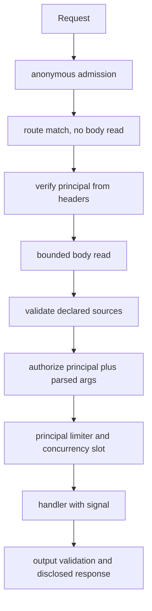

# Security boundaries

never-rest is a contract and admission layer. It is not an identity provider, a WAF, or a mesh. This page states the order a request walks, the controls the library owns, and the controls that stay with the deployment.

## Admission order

HTTP:



Local dispatch skips the network steps. The adapter supplies the principal; then validation, authorization, admission, and the handler run. A protected operation without a principal returns `boundary.unauthenticated`.

Unmatched paths still go through anonymous admission when it is configured, then return `route_not_found` without reading a body.

## What never-rest owns

| Control | Where |
| --- | --- |
| Declared input and output schemas | `ContractDef` / `parseRouteSources` / `parseOutput` |
| Graded disclosure | `disclose`; `message` and `issues[].message` are always public |
| Mandatory operation policy | `definePolicy` — coverage checked at construction |
| Bounded JSON ingress | `ServeOptions.limits` (default 1 MiB, 30 s) |
| Streaming Node bridge | `toNodeHandler({ maxBodyBytes, bodyTimeoutMs })` |
| Typed boundary errors | reserved `boundary.*` codes; HTTP statuses owned by `serve` |
| Admission limiters and concurrency | `./limits`; `onStoreFailure` is required |
| Cancellation | `signal` on handlers, local dispatch, and the client |
| Explicit retry | `isRetryable` and `withRetry({ idempotent })` |

Policy is a map, not middleware. See [advanced-usage.md](./advanced-usage.md).

## What the deployment owns

never-rest does not terminate TLS, parse `X-Forwarded-For`, issue tokens, or share limiter state across replicas.

| Control | Owner |
| --- | --- |
| TLS, certificates, HSTS | Load balancer / platform |
| Firewall, WAF, bot scoring | Edge |
| Client certificates / mTLS | Ingress |
| OAuth / OIDC issuer and user directory | Identity provider |
| VPN / private network | Platform |
| Trusted-proxy client IP | Ingress; pass a key you already verified |
| Node `requestTimeout`, `headersTimeout`, `maxHeaderSize` | Node process / `http.createServer` |
| Proxy and CDN body limits | Ingress, *before* the process |
| Hosts that parse the body before `serve` sees it | That host (some frameworks buffer first) |
| Distributed rate-limit store | Your Redis / memorystore adapter |
| Worker-pool cancellation for CPU work | Application — see [`examples/cancellation`](../examples/cancellation) |

### Trusted-proxy keys

never-rest will not read `X-Forwarded-For`. If anonymous admission needs a client key, take it from a header your proxy overwrites, or from a value the host already verified:

```ts
admission: {
  anonymous: {
    limiter,
    key: ({ request }) => request?.headers.get('x-edge-client-key') ?? 'anonymous',
  },
  onStoreFailure: 'reject',
}
```

A store failure never silently allows unlimited work. `onStoreFailure` is `'reject'` (503 `boundary.overloaded`) or `{ fallback }` to another `Limiter`.

`createMemoryLimiter` is single-process. State resets on restart and is not shared between replicas. Use `fromRateLimiterFlexible` when the store lives elsewhere.

## Disclosure contract

`message` and `issues[].message` are public data. They are kept at every disclosure level. The `nextStep` regex is a defensive heuristic, not redaction. Secrets belong in `cause` or `ctx`.

`createDispatcher` defaults to `public` because it serves foreign transports. `createLocalClient` defaults to `full` because it is module-to-module. `serve` omitted disclosure is `public`. Do not raise disclosure from a caller header.

## What never-rest does not ship

- An OAuth issuer, user directory, VPN, TLS terminator, or firewall
- A distributed limiter implementation
- MCP authorization servers or transport security
- A public-message template catalogue
- Parsing of forwarding headers

Those stay in the host that mounts the contract.
